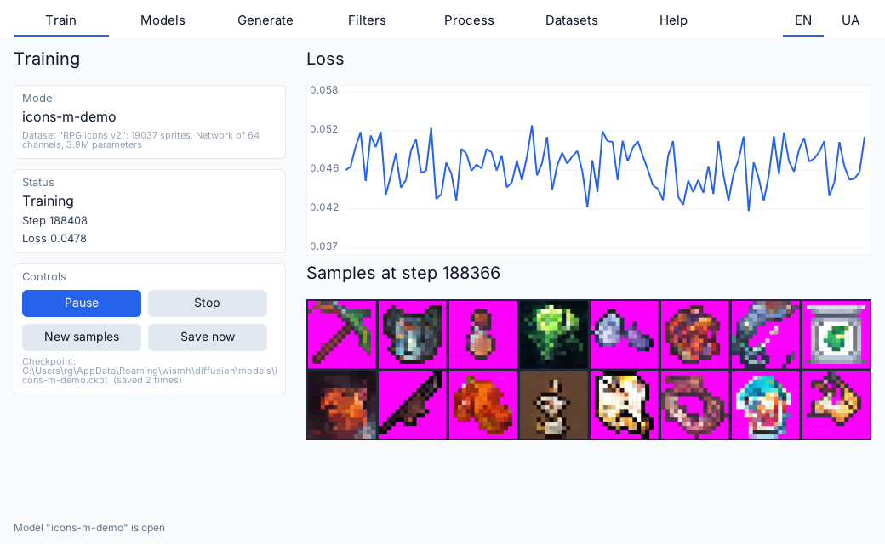
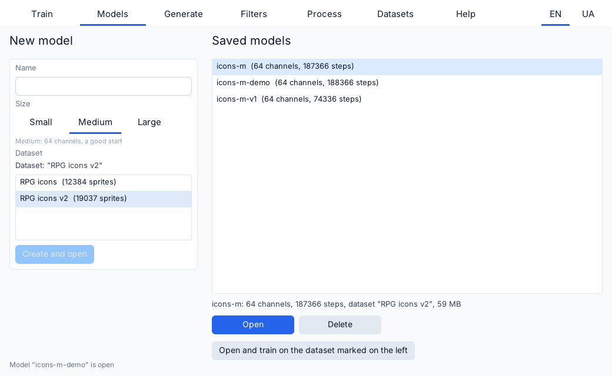
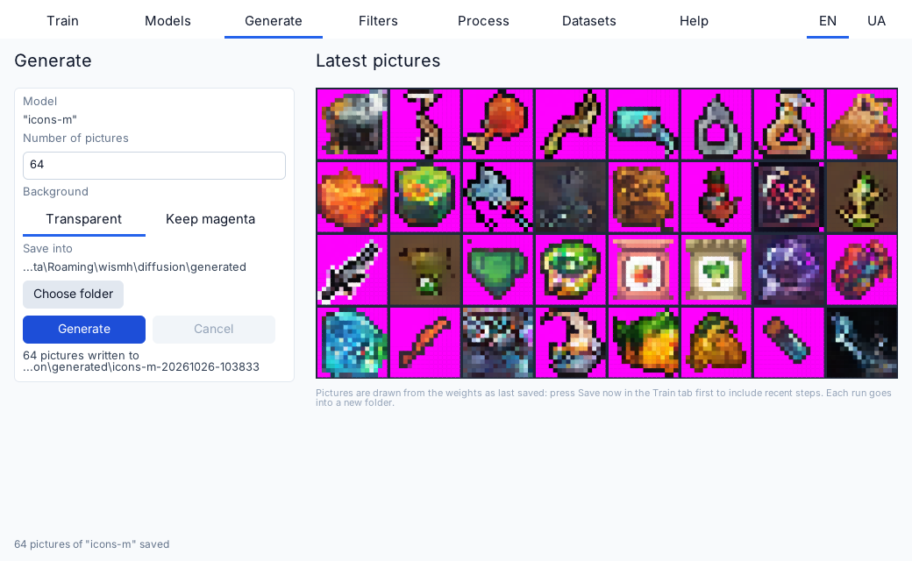
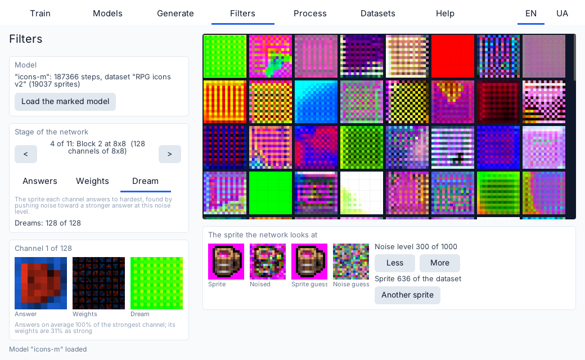
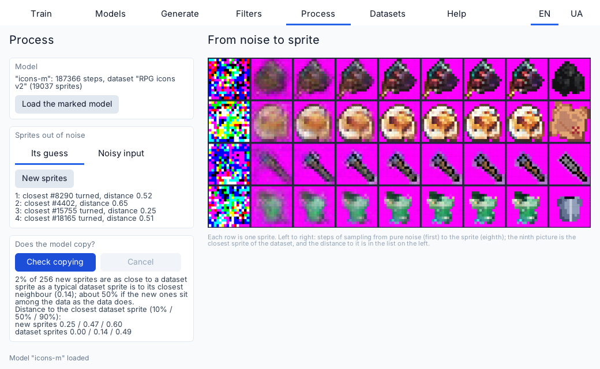
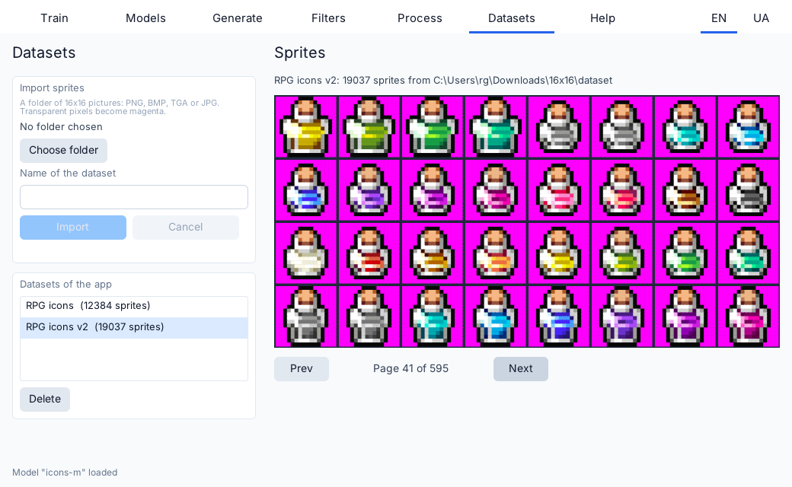
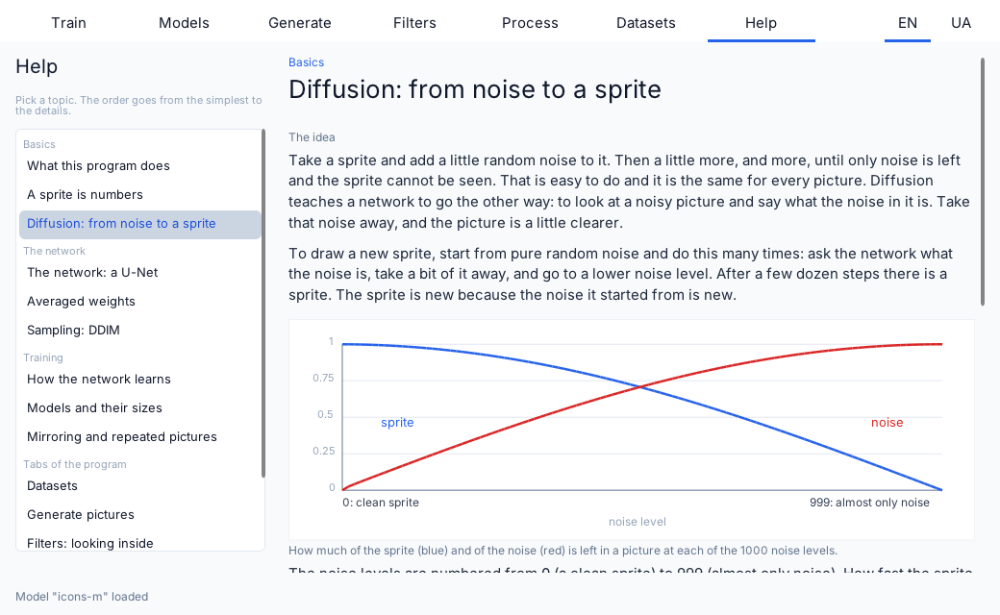

# Sprite Diffusion

An interactive denoising diffusion model that draws 16x16 RGB sprites, written in C++23 and CUDA on top of the [Wind engine](https://github.com/wismh/wind-engine). A U-Net learns to remove noise from pictures, and then draws new ones out of pure noise. Everything is written here, kernels included: there is no cuDNN and no cuBLAS.

The program is also a learning tool. You can turn any folder of small pictures into a dataset, train models of three sizes on it, stop and continue a run exactly where it stopped, and look inside the network: what each channel answers to, what its filters look like, what it dreams of, and how a sprite comes out of noise step by step. A built-in reference explains the ideas behind each step. The screenshots below were made with a dataset of 19037 RPG item icons.



## Features

- **Train.** Start, pause, resume and stop the open model. The tab shows the step, the loss (a chart on a logarithmic scale) and a grid of the sprites the model draws now, refreshed every 250 steps or on demand. Training runs on a thread of its own, saves a checkpoint every 500 steps and when it stops, and the model that was open comes back at the next start.
- **Models.** Make a model: a name, a size (Small 32 channels, Medium 64, Large 96) and the dataset it learns from. Saved models are listed with their size, steps and dataset. Open one to train it further, train it on another dataset, or delete it.
- **Generate.** Draw any number of sprites with a saved model and write them as 16x16 PNG files in a new folder. The background can be made transparent (pixels close to magenta).
- **Filters.** Look at the network one stage at a time, a picture per channel: its answers to a sprite at a chosen noise level, its weights (the 3x3 filters), and its dream, the sprite it answers to hardest, found in the background by gradient ascent. Picking a channel shows all three, larger.
- **Process.** See how sprites come out of noise: the steps of sampling, as the network's guess of the sprite or as the noisy input it was fed, and the sprite of the dataset each result is closest to. A check draws 256 sprites and counts how many are closer to a dataset sprite than one in ten dataset sprites are to their nearest neighbour, which tells whether the model copies its training data.
- **Datasets.** Pick a folder of 16x16 pictures (PNG, BMP, TGA, JPG; subfolders are read too) and import it under a name. A pixel with alpha of 128 or more keeps its color, any other becomes magenta, so the sprites are opaque and the background marks what was transparent. The tab lists the datasets and shows their sprites, page by page.
- **Help.** A reference in short topics, from what a diffusion model is and how a sprite comes out of noise to the U-Net, training, the tabs of the program and why sprites sometimes come out as a mess, with formulas and figures.
- **Two languages.** The window and the reference are in English and Ukrainian (the EN and UA buttons at the right of the tabs); the choice is remembered.

## Screenshots

### Models



### Generate



### Filters



### Process



### Datasets



### Help



## How it works

A sprite is 3 planes of 16x16 values in the range -1 to 1. Noise is added to it over 1000 levels that follow the cosine schedule, so the picture is destroyed evenly instead of in the first few steps. The network is a U-Net on 16x16, 8x8 and 4x4 maps, built from residual blocks with GroupNorm and SiLU, and a sinusoidal embedding of the noise level. It is trained to predict the noise that was added to a sprite at a random level.

Training is Adam (learning rate 0.0003, batches of 64) on the mean squared error of the predicted noise. Sprites are shown to the network both as they are and mirrored left to right. An exponential moving average of the weights (decay 0.999) is kept next to the weights, and it is the average that draws new sprites: starting from pure noise, 50 DDIM steps instead of one per noise level turn it into a sprite. The previews of the Train tab use 30 steps.

A checkpoint holds the weights, the average, the moments of Adam and the state of the random generator in one file, so after loading it training goes on exactly as if it had never stopped. It is written beside its final name and renamed, so a failed write never leaves half a file.

The kernels (matrix multiplication, convolution, group normalization, SiLU, upsampling, Adam) are tested against CPU references and finite differences. The game module only turns what the model gives into text, pictures and buttons: a long task (an import, a generation, the copy check) runs in a background job with a cancel button and one result.

## Datasets

The program does not ship with sprites. Make a folder of 16x16 pictures, open the Datasets tab, choose the folder, give the dataset a name and press Import. Files that are not 16x16 pictures are skipped and counted. Any set of small pictures will do: item icons, tiles, faces, pixel art characters. Check the license of a dataset before you use it for anything beyond learning.

## Build, run and export

The project is built, run and exported with the Wind Editor, which is part of the [wind-engine](https://github.com/wismh/wind-engine) repository. It needs the Wind SDK (the version in `wind_project.toml`), the CUDA Toolkit and MSVC, and an NVIDIA video card (the kernels are built for Turing, sm_75, and newer cards run them too).

1. Open the Wind Editor and open this folder as a project (it contains `wind_project.toml`).
2. Press **Play**. The editor builds the game module and starts the game.
3. To make a standalone build, use the editor's **Export**, or build it by hand:

```
cmake -S . -B build-export -G "Ninja Multi-Config" -DCMAKE_CONFIGURATION_TYPES=DebugGame;Release -DCMAKE_PREFIX_PATH=<path to the Wind SDK> -DWIND_EXPORT=ON
cmake --build build-export --config Release
```

`bin\Release\diffusion.exe` with its `assets` folder is the game; it needs only the NVIDIA driver.

## Saved files

Datasets and models are stored in the per-user data directory of the game (organization `wismh`, application `diffusion`, that is `%APPDATA%\wismh\diffusion` on Windows), together with the chosen language. Nothing is written into the project folder.

- `datasets\*.spds`: a dataset, its background color, where it came from and the 16x16 sprites as bytes, with a checksum.
- `models\*.ckpt`: a model, its size, the number of steps, the name of its dataset and all that is needed to go on training.
- `generated\<model>-<time>\`: the PNG files of one generation run.
- `locale.txt` and `last_model.txt`: the language and the model that was open.

## Project layout

```
src/cuda/     The model: tensors, GEMM and convolution kernels, layers, U-Net, diffusion, trainer, checkpoints.
src/data/     Sprites in and out: datasets, importer, stores of datasets and models, PNG writer, the background job
              that the importer and the other long tasks run in.
src/inspect/  What is done with a trained model: drawing sprites to files, the copy check, the nearest sprite of the
              dataset, and the numbers and small pictures that the Filters, Process and Train tabs show.
src/view/     Painters and view models of the UI (a list of names, the paints).
src/          The app: game, session (an open model), inspection (a model loaded for looking into), the panels of the tabs.
assets/       UI (XML and CSS), the help topics and the messages in two languages (generated, see tools/).
tools/        Command-line tools, and the Python scripts that write the messages (gen_locale.py) and the help (help/gen_help.py).
tests/        Unit tests.
docs/         Screenshots.
```

`src/cuda`, `src/data` and `src/inspect` are static libraries with no engine types in them; the game module, the tools and the tests link the same code. `src/session.cpp`, `src/inspect_session.cpp` and `src/loc/locale_prefs.cpp` have none either, and the tests compile them from there.

## Tests and tools

The tests (GoogleTest, taken from the Wind SDK; they need the GPU) cover the kernels, the layers, the whole network, checkpoints, the trainer, the dataset and model files, the importer, the generator, the background jobs, the sessions of an open and of an inspected model, the numbers behind the Filters, Process and Train tabs and the saved language. They are off by default so that building in the editor does not compile them. To build and run them, configure with the `tests` preset and pass the path to the Wind SDK:

```
cmake --preset tests -DCMAKE_PREFIX_PATH=<path to the Wind SDK>
cmake --build build-tests --config Release
ctest --test-dir build-tests -C Release
```

Tools, built with the tests: `train_demo` (train on generated sprites and write sample grids), `bench` (time of a training step), `import_dataset` (the import of the Datasets tab from the command line).